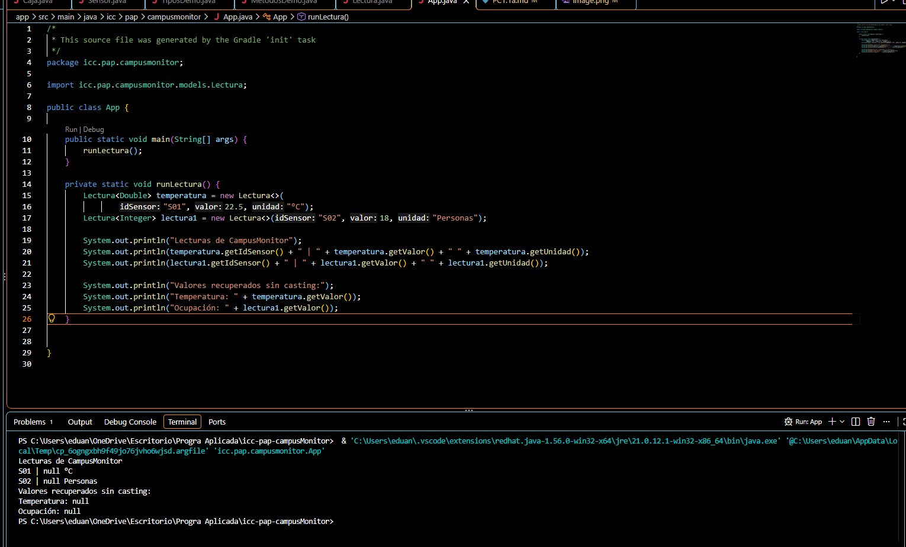

## Qué representa la clase Lectura<T>
La calse lectura <t> representa una clase generica encapsula 3 datos lectura, valor y su unidad 
## Qué representa T y por qué permite utilizar la misma clase para temperatura y ocupación.
T es el parametro del valor medido, se usa la misma para no repetir clases
## Qué agregaste en App.java.
basicamente aqui es el main donde imprime los valores que le dimos
