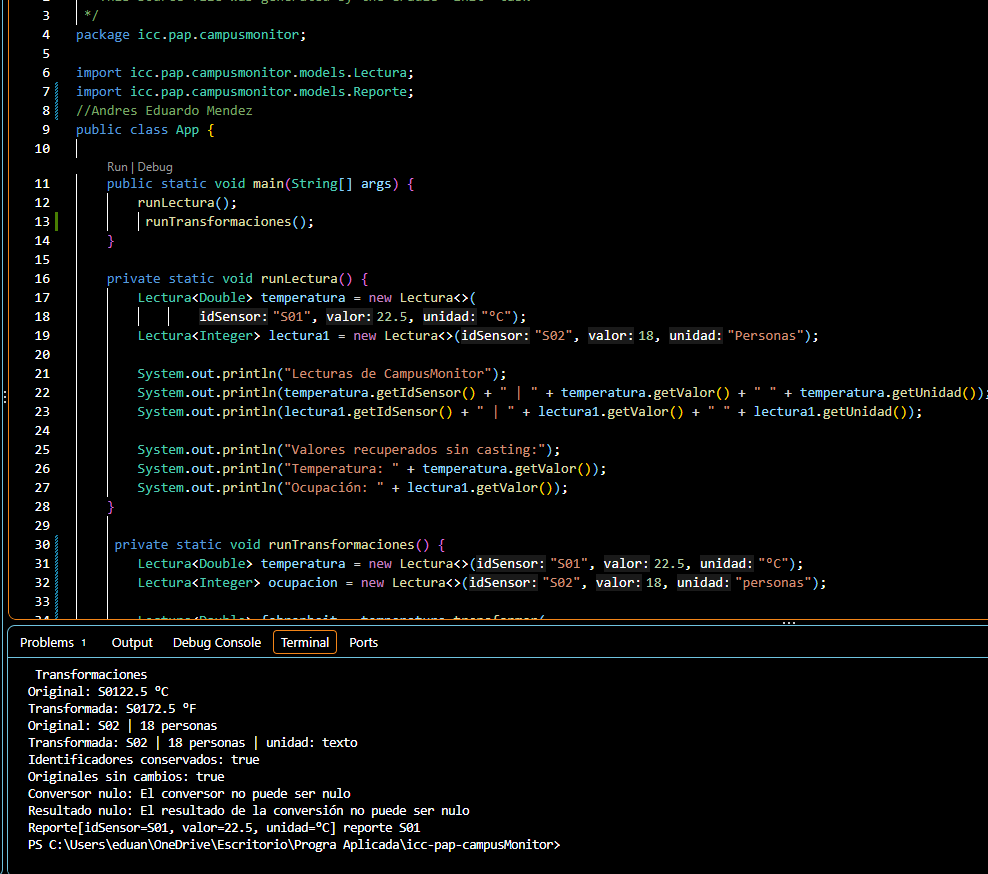

## Explicacion
En esta practica R representa el tipo de resultado que produce la conversion, lo que permite que una Lectura <T> se transforme en una Lectura<R> con un tipo distinto, aqui transdormar es generic ya que tiene <R>, runTransformaciones no es generic porque solo invoca metodos genericos, en lectura agruege un metodo publico que instancia <R> Lectura<R>transformar ya que esto transforma el valor que tiene y lo devuelve en una nueva lectura, aqui tambien usamos java.util.function.Function, tambien usamos la formula para cambiar la temperatura de Celsius a Farenheit, despues de transformar recuperamos el valor sin casting
En App agregue el metodo privado private static void runTransformaciones() invocado desde main junto a runLectura(); 
aplique la transformacion y lo guardo, luego agruegue unos try y catch por si hay datos sueltos o que no son 
## 2
Al imprimir el valor y la unidad del objeto original antes y después de cada llamada a transformar, demuestra que el metodo devuelve una instancia nueva sin cambiar de donde  vino . Que el resultado tenga otro tipo comprueba  que R  resuelve independientemente de T.
## 3
Para la otra practica hicimos una nueva clase llamada Reporte, ya que queriamos pasar de Lectura a Reporte, esta entendi mas ya que no teniamos que usar ninguna formula fue de forma directa 
